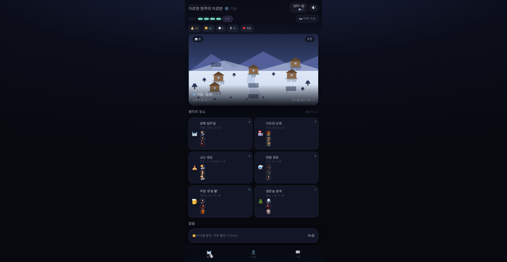

# 🏰 레카텐 변경 영주 · 아르덴의 봄 (v2)

《외뿔의 악마》 세계관(마왕 도래 이전)의 **변경 영주 샌드박스 시뮬레이션**.
신성 타이셀 왕국 북부, 검은숲과 맞닿은 변경령 **아르덴**의 영주가 되어
영지를 다스리고, 사람을 만나고, 사랑하고, 가족을 이룬다.

## 플레이

👉 https://sdmetj.github.io/rekathen-lord/



- 모바일 세로 화면 최적화 · 모던 인디 다크 UI
- **사계절 × 연차 샌드박스** — 30일 강제 종료 없음. 패배(축출) 시에만 게임오버
- **54명의 인물** — 핵심 네임드 13인(전용 도트) + 변경 인물 41인, 성격 14종

## 시스템

| 요소 | 내용 |
| --- | --- |
| 하루 루프 | 오전 → 오후 → 밤, 행동력 4~5. 장소를 자유롭게 오가며 쓴다 |
| 장소 | 성채 집무실 · 아르덴 상회 · 교단 성당 · 연금 공방 · 주점 '은빛 뿔' · 검은숲 경계 · 영주 저택 |
| 영지 개발 | 건물 9종을 짓고 올리면 지도 위 모습이 실제로 변한다 (폐허 → 목재 → 석조 → 깃발) |
| 상회 경영 | 매일 바뀌는 시세, 사단가 흥정, 재료 → 제작 → 기한부 납품 의뢰 |
| 전투 | 검격 · 강하게 · 물약 · 이탈. 호감도가 높은 동료의 지원 스킬 발동 |
| 대화 | 태도 칩 10종 + **프리토크(자유 입력)** — 문장의 의도·감정톤을 파싱해 성격별 말투로 응답 |
| 로맨스 | 호감도 0~1000(10하트), 2·4·6·8하트 이벤트, 고백 → 연인 / 혼인 / 별채(첩) |
| 가족 | 혼인 상대는 저택 내실에 상주(내조 버프). 임신 → 출산 → 이름 짓기 → 유년기 성장 |
| 성향 | 선택과 말투가 영주의 평판 태그(다정 · 호탕 · 교활 · 자비 · 충의 · 냉혈)를 바꾼다 |
| 원작 인물 | 엘렌 · 라나 · 밀 · 레베 · 벨로아 · 타론 · 스가르테론 · 도런 — 서사를 파고들면 숨긴 연애 루트가 열린다 |
| 엔딩 | 강제 엔딩 없음. 마일스톤(혼인 · 출산 · 성벽 · 부 · 민심) 축하 팝업 후 계속 |

## 아트

전신 15종 · 초상 13종 · 배경 6종을 생성해 `tools/pixelize.py`로 후처리한다.

1. 단색 마젠타 배경 제거 (테두리 flood-fill + 마젠타 헤일로 중화 + 잔여 화소 정화)
2. 실제 도트 격자(전신 176×240, 초상 200×200, 배경 400×225)로 축소
3. 32색(배경 48색) 팔레트 양자화 · 디더링 없음
4. 1px 외곽선 + 정수배 NEAREST 업스케일

변경 인물 41인은 핵심 도트를 베이스로 **캔버스 팔레트 스왑**(채도 있는 픽셀만 색상 회전)으로
개별 머리색·눈빛·복장 색감을 부여한다.

```bash
python3 tools/pixelize.py all .
```

## 파일

```
index.html          화면 셸
css/style.css       모던 인디 다크 UI
js/data.js          세계 · 건물 · 사건 · 아이템 · 계절
js/chars.js         54인 인물 명부 (핵심 13 + 변경 41)
js/talk.js          프리토크 파서 · 태도 액션 · 하트 이벤트 · 질투
js/audio.js         Web Audio 효과음
js/game.js          상태 · 하루 루프 · 시설 · 상회 · 전투 · 가족
js/ui.js            렌더 · 지도 SVG · 채팅 · 시트
assets/*.png        도트 스프라이트 · 초상화 · 배경
tools/pixelize.py   스프라이트 후처리 파이프라인
```

## 고지

《외뿔의 악마》의 세계관을 바탕으로 한 비공식 팬 프로토타입입니다. 소설 본편의 설정(레카텐 대륙,
타이셀 왕국, 하이레프티아 교단, 씨앗·발아·개화 마법, 원뿔늑대, 외뿔·오른뿔, 은빛매, 비아)을 따르되,
아르덴 변경령과 게임용 인물의 세부는 이 게임을 위해 새로 만든 것입니다.
